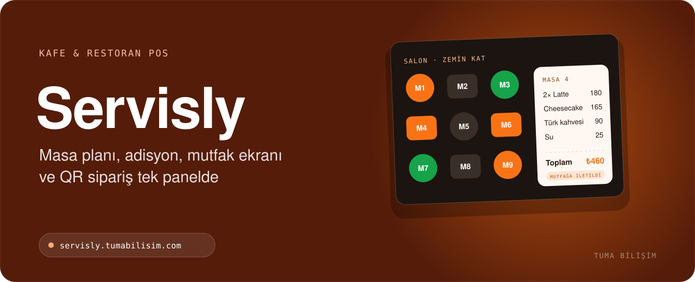

  

    

<h3 align="center">Kafe ve restoranlar için uçtan uca POS sistemi. Kendi sunucunuza kurulur; aylık kira, sürpriz ücret yok.</h3>

 

## 🎯 Kimler için?

- Kafe, restoran ve barlar
- Zincir işletmeler
- Kiralık POS yerine kendi sistemine sahip olmak isteyenler

## ✨ Öne çıkan özellikler

- Sürükle-bırak masa planı ve masa yönetimi
- Dokunmatik ekrana uygun hızlı adisyon
- Mutfak ekranı (KDS) ile canlı sipariş akışı
- QR menüden self-servis sipariş, doğrudan mutfağa
- Ürün bazlı hesap bölme, parçalı ve puanla ödeme
- Reçete ve maliyet, stok ve fire takibi, gider yönetimi
- Gün sonu (Z) raporları, paket servis ve kurye yönetimi
- Rezervasyon, sadakat puanı, rol bazlı yetki, vardiya ve kasa yönetimi

## 🧱 Teknoloji

`PHP` `MySQL` `JavaScript` `QR`

## 📬 Demo, kurulum ve fiyat

Servisly için canlı demo, kurulum ve fiyat bilgisi almak isterseniz:

- 🌐 **Teklif formu:** [tumabilisim.com/iletisim](https://tumabilisim.com/iletisim?urun=Servisly)
- 💬 **WhatsApp:** [+90 533 432 15 12](https://wa.me/905334321512?text=Merhaba%2C%20Servisly%20hakk%C4%B1nda%20bilgi%20almak%20istiyorum.)
- ✉️ **E-posta:** [info@tumabilisim.com](mailto:info@tumabilisim.com?subject=Servisly%20hakk%C4%B1nda)

İşletmenize özel uyarlama ve entegrasyon da yapıyoruz.

---

<b>🇬🇧 English</b>

 

**Servisly** — All-in-one café & restaurant POS: floor plan, fast touch ordering, kitchen display system, QR self-ordering, split bills, recipes & stock, reservations and Z reports. Installed on your own server — no monthly rent.

Live product: https://servisly.tumabilisim.com/ · Contact: [info@tumabilisim.com](mailto:info@tumabilisim.com) · WhatsApp: [+90 533 432 15 12](https://wa.me/905334321512)

---

Bu depo ürün tanıtımı içindir. Ürün ticari bir yazılım olduğundan kaynak kodu paylaşılmamaktadır. Kurulum, demo ve fiyat bilgisi için iletişime geçin. 
Tasarım & Geliştirme: <a href="https://tumabilisim.com">Tuma Bilişim</a> · <a href="https://github.com/gkhnfyz">@gkhnfyz</a>
